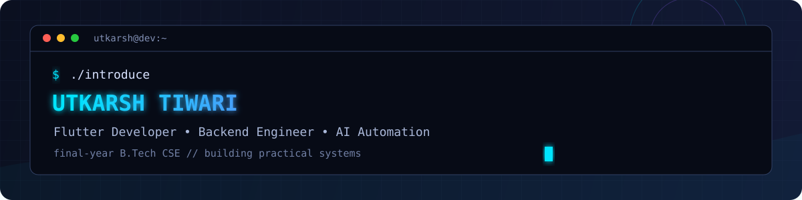

<div align="center">
  
</div>

<br />

<div align="center">
  <a href="https://github.com/codemacUT?tab=repositories">
    
  </a>
  
</div>

<br />

```text
> whoami
Utkarsh Tiwari — final-year B.Tech Computer Science student

> mission
Build thoughtful mobile products, reliable backend systems, and practical AI automation.
```

## `./now`

```diff
+ Building production-minded Flutter experiences
+ Exploring backend architecture and system design
+ Working with AI APIs, workflow automation, and developer tooling
+ Strengthening data structures and algorithms
```

## `./stack`

<div align="center">
  
</div>

<br />

<div align="center">
  <code>Languages: C++ · Java · Dart · SQL</code>
  <br />
  <code>Mobile: Flutter</code>
  <br />
  <code>Backend & data: Node.js · Express · PostgreSQL · Firebase · Supabase · REST APIs</code>
  <br />
  <code>Automation & tooling: AI APIs · n8n · Git · Docker · Linux</code>
</div>

## `./selected-work`

<table>
  <tr>
    <td width="50%" valign="top">
      <h3>🏋️ LiftOS</h3>
      <p>An offline-first gym tracking application.</p>
      <sub>Flutter · Mobile development</sub>
    </td>
    <td width="50%" valign="top">
      <h3>📍 Smart Attendee</h3>
      <p>An attendance management system with location verification.</p>
      <sub>Flutter · Express · PostgreSQL · JWT</sub>
    </td>
  </tr>
  <tr>
    <td width="50%" valign="top">
      <h3>🎨 Prompt2Pic AI</h3>
      <p>A Telegram bot for AI image generation using Gemini and n8n workflows.</p>
      <sub>Gemini API · n8n · Telegram</sub>
    </td>
    <td width="50%" valign="top">
      <h3>📊 BusinessCanvas</h3>
      <p>A project exploring product and business workflows.</p>
      <sub>View the repository for implementation details</sub>
    </td>
  </tr>
</table>

## `./experience`

```text
[ Flutter Developer Intern ]
  Shipped and supported mobile-development work in a professional environment.

[ Paytm — Operations & GIS Analytics Intern ]
  Worked at the intersection of operations and GIS analytics.
```

## `./github`

<div align="center">
  
  
</div>

<br />

<div align="center">
  
</div>

<div align="center">
  <sub>Open to software-development opportunities and interesting engineering conversations.</sub>
</div>
